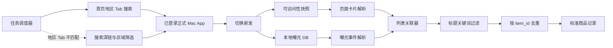
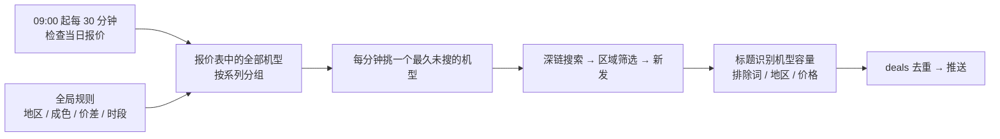

# Mac 闲鱼 App 商品监控技术设计

状态：已完成最短链路验证；已落地每日报价驱动的自动搜索、地区筛选和管理后台（见第 11 节）。

## 1. 目标

使用本人已登录的 Mac 版闲鱼监控指定关键词的新发布商品，并尽量减少网页验证码、代理环境识别和原生签名维护成本。

方案只覆盖商品发现、去重和向现有业务管道输出结构化记录。它不修改闲鱼客户端、不伪造登录态，也不直接重放原生 MTOP 请求。

## 2. 总体架构



正式 App 通过原生 MTOP 网关生成合法请求。采集端只观察已经渲染到页面和写入本地数据库的数据，不改变系统代理、证书或请求头。

## 3. 搜索触发

优先读取首页底部可访问的地区 Tab，并按城市名匹配目标地区，不固定假设目标一定在第二个 Tab。匹配到「厦门」时，从该地区 Tab 发起搜索；该首页信息流已按城市定位，因此跳过结果页的「福建 > 厦门」筛选，避免重复操作。

当前可访问的地区 Tab 中没有目标城市或首页搜索失败时，回退到正式 App 支持的深链：

```text
fleamarket://idle_search_result?keyword=<关键词>&searchReqFromPage=home&searchTabType=SEARCH_TAB_MAIN
```

进入结果页后等待“新发”实际出现在可访问性树，再执行点击。采集固定只点「新发」，减少排序切换和误点。点击器优先使用元素自身动作和文字中心坐标，避免 Rax 大容器误接收父元素动作。已验证“新发”会形成：

```text
sortField=create
sortValue=desc
```

页面加载完成后立即读取可访问性树和本地曝光事件，缩短两份数据之间的时间差。

## 4. 数据来源

### 4.1 可访问性树

已验证可以直接读取以下展示信息：

- 完整商品标题；
- 展示价格；
- 页面展示的地区；
- 卖家或商品标签；
- 首屏卡片顺序。

这部分是结构化的系统可访问性文本，不需要 OCR。

### 4.2 本地曝光数据库

数据库位置：

```text
~/Library/Containers/com.taobao.fleamarket/Data/Library/walle_ut_user_track.db
```

只读查询 `usertrack` 表中以下事件：

```text
page_name = Page_xySearchResult
arg1      = Page_xySearchResult_Appear-Item
event_id  = 2201
```

事件的 `args` 字段包含 `expdata`，当前已验证可解析：

- `id` / `item_id`：商品 ID；
- `keyword`：搜索关键词；
- `displayPrice` / `price`：展示价格；
- `publishTime`：毫秒级发布时间；
- `index`：列表位置；
- `page`：页码；
- `tagname`：部分展示标签。

`p_city` 在本次验证中表示当前用户位置，不能当作卖家或商品地区。地区以可访问性树的展示文本为准。

### 4.3 标准 URL 缓存

以下缓存中只观察到 `mtop.taobao.idlemtopsearch.search.shade/3.0` 的搜索框推荐配置：

```text
~/Library/Containers/com.taobao.fleamarket/Data/Library/Caches/
  com.taobao.fleamarket/Cache.db
```

没有发现包含完整 `resultList` 的商品搜索响应，因此它不作为正式数据源。

## 5. 数据关联

一次采集周期使用以下约束关联页面卡片和曝光事件：

1. 搜索关键词相同；
2. 曝光时间位于本次页面加载时间窗内；
3. 列表索引一致；
4. 展示价格一致；
5. 标题通过本地关键词规则复核。

关联成功后，商品 ID 是主键。列表索引只用于本轮配对，不能作为长期标识，因为推荐和广告可能导致卡片重排。

建议输出的数据契约：

```json
{
  "item_id": "1091953070170",
  "keyword": "trackpad",
  "title": "商品标题",
  "price": "640",
  "published_at": "2026-10-18T20:09:03+08:00",
  "display_region": "上海",
  "tags": ["发货极快"],
  "list_index": 1,
  "observed_at": "2026-10-18T20:17:44+08:00",
  "source": "mac_app_local_observation"
}
```

## 6. 运行流程

每个关键词的一轮采集按以下顺序执行：

1. 检查闲鱼 App 已运行且处于登录状态；
2. 打开搜索深链；
3. 等待结果页出现关键词和排序栏；
4. 点击“新发”，等待首屏卡片稳定；
5. 记录当前数据库最大行号和采集时间窗；
6. 读取可访问性卡片；
7. 以 SQLite 只读模式读取新增曝光事件；
8. 关联两份数据并执行标题关键词过滤；
9. 按商品 ID 去重，输出新增商品；
10. 出现登录失效、空结果或页面结构变化时停止该关键词本轮采集。

需要更多结果时再执行有限滚动，并在每次滚动后建立新的时间窗。首个版本应只验证首屏，避免把滚动、分页和通知同时引入。

## 7. 风险与边界

- 读取本地 DB 不产生网络请求，服务端无法从网络侧观察该读取动作。
- 搜索和滚动仍是服务端可见行为，不能假设 App 没有频率控制。
- 不配置 Charles、mitmproxy 或自签 CA，避免代理和证书固定问题。
- 不保存请求 Cookie、Token、签名、WUA、用户 ID 或完整埋点原文。
- “新发”可能混入相关召回商品，必须复核标题，不能只相信排序标签。
- 本地埋点只覆盖已经曝光的卡片，未展示的商品不会出现。
- App 更新可能改变可访问性树、事件名和字段，需要版本化兼容检查。

## 8. 实现阶段

### 阶段 A：稳定性验证

- 连续人工触发多个关键词，验证标题、价格、索引与 DB 商品 ID 的关联准确率；
- 验证 App 重启、登录过期、无结果和相关召回页面；
- 确认本地 DB 事件写入延迟和保留周期。

### 阶段 B：只读采集器

- 深链启动器；
- 登录状态与页面状态检测；
- 可访问性卡片解析；
- SQLite 增量读取；
- 数据关联和本地去重。

### 阶段 C：接入现有业务管道

- 将标准商品记录传给关键词过滤或 AI 分析；
- 复用通知模块；
- 增加任务状态、失败退避和可观测性。

## 9. 首版验收标准

- 不配置系统代理或证书；
- 登录状态下能读取发布时间不超过 15 分钟的商品；
- 首屏商品标题、价格、商品 ID 和发布时间关联准确率达到 95%；
- 相同商品 ID 不会重复通知；
- 登录失效或页面结构无法识别时停止采集，不继续盲目点击；
- 输出数据不包含登录凭据和原始埋点中的个人字段。

## 10. 报价匹配

爱玖回收每日报价是价格基准。报价图片通过 macOS Vision OCR 转换为 `机型 + 容量 + 成色 + 报价`，后台允许人工修正识别结果。

商品标题必须能确定机型与容量。每日价格是回收报价；允许挂牌价高于该报价一定金额，以纳入可议价的商品。推送上限为：

```text
回收报价 + 允许高出金额
```

商品价不高于该阈值、且不低于 `报价 × 过低价比例` 时保存命中记录，并按商品 ID 去重后发送通知。

## 11. 每日自动流程（v0.2）

v0.2 取消了逐个手动创建的监控任务，改为一套全局规则，搜索目标从报价表自动推导。



### 11.1 报价刷新

- 报价接口不是闲鱼的，每天早上更新。`APP_MONITOR_QUOTE_HOUR:MINUTE`（默认 09:00）起每 30 分钟检查一次，持续 3 小时；
- 某分类当天已经抓到新图片（`fetched_at` 为今天）即视为最新，不再下载。报价图片 URL 中的日期可能比实际晚一天，不能单独依赖；
- 服务在报价时间之后启动时，会立即补做一次检查。

### 11.2 规则与搜索目标

规则保存在 `app_state.rules`，后台「监控规则」页可修改：

| 规则 | 默认值 | 说明 |
| --- | --- | --- |
| 城市 / 区域点击路径 | 空 | 空表示全国；填写城市后自动生成 `区域 > 省 > 市 > 查看`（选完必须点右下角「查看」） |
| 参考报价 / 参考成色 | 苹果无保 / 小花 | 标题无法判断成色，统一按该档判价 |
| 允许高出回收报价 | 200 元 | 报价 ¥4900 时，挂牌价不超过 ¥5100 可进入推送候选 |
| 过低价比例 | 0.3 | 低于报价 30% 视为引流或非整机 |
| 排除词 | 回收、求购、ID锁、配件等 | 标题含任一词不推送 |
| 搜索时段 / 机型间隔 | 09:00–23:00 / 30 分钟 | 支持跨午夜时段 |

每个机型对应一个关键词，例如 `iPhone 15 Pro`；`17 Air` 使用卖家常用的 `iPhone Air`。同一机型的各容量共用一次搜索，优先按标题中的容量判价；标题未写容量时，使用该轮已成功应用的容量筛选。

### 11.3 调度

- 调度器每 15 秒检查一次，空闲时发起一次搜索，挑选距上次搜索最久且已超过间隔的机型；
- 所有搜索串行执行，手动「立即搜索」与定时搜索共用一把锁；
- 连续 3 次搜索失败后暂停 10 分钟，避免 App 未运行或权限缺失时反复操作；
- 每次搜索写入 `search_runs`，每件商品的判价结论写入 `observed_items.decision`。

### 11.4 地区

两层保证：

1. **App 内区域筛选**：打开搜索后按点击路径依次点击。`ax_snapshot.swift --click-path` 对每一步先找文字完全一致的元素，找不到时找包含目标文字、长度相近或以目标文字开头（如「查看 2.3万 件」）的元素；`AXPress` 失败时依次尝试父元素，最后在元素中心模拟鼠标点击。界面加载期间每步最多重试约 3 秒。
2. **卡片地区复核**：从价格附近的短文本中识别卡片地区，再与目标城市比较：包含城市名或已知区县（厦门已内置思明、湖里等）视为本地；明确是其他城市或省份的不推送；无法判断的只有在本轮区域筛选成功时才接受。

切换区域后才记录曝光 DB 的起始行号，再点击「新发」，保证读取的曝光记录只来自最终的筛选结果。

### 11.5 容量筛选与多轮读取（v0.3）

调度单元为「机型」，一次搜索的完整步骤：

1. 深链打开 `iPhone <机型>` 的搜索结果；
2. 按区域点击路径切换地区；
3. 对该机型每个启用容量依次按筛选路径（默认 `筛选 > 存储容量 > {容量} > 确定`）切换容量；关键词搜索页只打开一次；
4. 每个容量分别记录曝光 DB 当前最大行号 → 点击「新发」→ 等待 4 秒 → 读取当前屏卡片 → 向下翻屏 `scroll_pages` 次（默认 3），每次等待 2 秒后再读卡片 → 读取这期间新增的曝光 → 关联；
5. 各容量结果按商品 ID 去重后判价。容量筛选失败时跳过该轮，避免把未确认容量的结果错误用于判价。

Mac 版窗口一屏只露出 2～4 件商品，第一页要翻屏才能全部曝光，曝光 DB 也只记录出现在屏幕上的商品。

区域：排序栏是「综合 · 价格 · 降价 · 新发 · 区域 · 筛选」，选过地区后「区域」位置显示城市名并在下次搜索时保留。搜索前先读一次可访问性树，该位置已是目标城市就跳过区域路径，是其他城市则把路径第一步换成该城市名。

容量筛选直接使用排序栏下方的容量标签打开弹层，不再先点宽泛的「筛选」。弹层内的容量文字对 `AXPress` 会虚报成功，因此只对「重置／确定」围住的容量格执行前台坐标点击；选好后点击「确定」，再核对结果页容量标签。切换容量时，先取消上一个选项，再勾选下一个选项；标签未变成目标容量时，本轮不采集商品，也不把容量当作判价依据。翻屏用 `--scroll`，在窗口中下部发送像素滚轮事件。容量筛选成功时，标题没写容量的商品按筛选的容量判价；标题写了容量时以标题为准。「新发」按钮找不到时会记录为本次搜索错误。

调度器每 15 秒检查一次，空闲时立即开始下一个到期机型。每款机型只打开一次搜索页，随后切换各个启用容量；同一机型的间隔按整次搜索计算。`disabled_models` 中 `15 Pro` 表示停用整个机型，`15 Pro|256` 表示只停用该容量，`@series:17` 表示停用整个 iPhone 17 系列。`search_runs` 中一行表示一款机型的一次搜索，`passes` 保存各容量的新发结果、商品数和错误。

### 11.6 数据表

- `deals`：命中商品，`item_id` 唯一，记录报价依据、价差、地区和推送状态；
- `search_runs`：每次搜索的机型、触发方式、看到的商品数、命中数、区域是否切换和错误；
- `observed_items` 增加 `model`、`storage`、`decision`、`matched` 列；
- `run_items`（v0.3.4）：每次搜索看到的每件商品的快照，包括所属轮次（筛选的容量）、价格、地区、报价依据、判价结论分类 `code`（matched / price_high / region / unrecognized / excluded / too_cheap / no_quote）以及是否本次新推送；后台「运行记录」据此展示单次搜索明细；
- 旧的 `monitor_tasks`、`matches` 表保留不动，不再使用。
