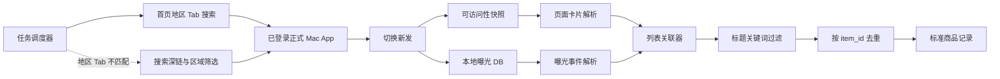
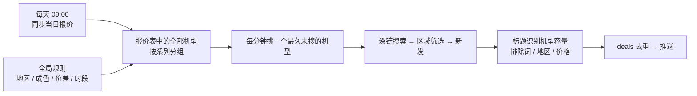

# Mac / iPhone 闲鱼 App 商品监控技术设计

状态（2026-10-21）：当前生产入口仅支持 iPhone。Mac 采集已禁用，历史代码保留，不参与设备选择或回退。下文 Mac 章节为历史设计参考；iPhone 链路见第 11.7 节，当前判价见 [description-pricing.md](description-pricing.md)。

OCR工具链：可在.env指定APP_MONITOR_SWIFT_SDK；报价和卖家徽章识别共享Swift子进程SDK配置，不改变系统全局选择。

报价同步：只有图片已成功解析且有报价条目才按哈希跳过；同图失败、中断或零条会复用批次重试，启动/定时/手动同步串行，状态页显示解析错误。详见 validation.md 第24节。

当前链路：iPhone 新发列表 → 允许成色最高价初筛 → 候选详情正文/参数/卖家/官方分享链接 → 本地关键词判档与报价扣费 → 可选 AI 复核 → 明确符合或待确认通知。未知的电池、拆修等按正常处理、不扣费；明确异常才处理。`matching.evaluate` 保留原固定成色模式，新的 `smart.price_facts` 负责纯函数判价。

## 1. 目标

使用本人已登录的 Mac 版闲鱼监控指定关键词的新发布商品，并尽量减少网页验证码、代理环境识别和原生签名维护成本。

方案只覆盖商品发现、去重和向现有业务管道输出结构化记录。它不修改闲鱼客户端、不伪造登录态，也不直接重放原生 MTOP 请求。

## 2. 总体架构



正式 App 通过原生 MTOP 网关生成合法请求。采集端只观察已经渲染到页面和写入本地数据库的数据，不改变系统代理、证书或请求头。

## 3. 搜索触发

优先读取首页底部可访问的地区 Tab，并按城市名匹配目标地区，不固定假设目标一定在第二个 Tab。匹配到「厦门」时，从该地区 Tab 发起搜索；该首页信息流已按城市定位，因此跳过结果页的「福建 > 厦门」筛选，避免重复操作。

当前可访问的地区 Tab 中没有目标城市或首页搜索失败时，回退到正式 App 支持的深链：

```text
fleamarket://idle_search_result?keyword=<关键词>&searchReqFromPage=home&searchTabType=SEARCH_TAB_MAIN
```

进入结果页后等待“新发”实际出现在可访问性树，再执行点击。采集固定只点「新发」，减少排序切换和误点。点击器优先使用元素自身动作和文字中心坐标，避免 Rax 大容器误接收父元素动作。已验证“新发”会形成：

```text
sortField=create
sortValue=desc
```

页面加载完成后立即读取可访问性树和本地曝光事件，缩短两份数据之间的时间差。

### iPhone 精确机型筛选

iPhone 进入搜索结果并确认地区后，先在第二行「品牌」入口选择「苹果/Apple」，点「全部」清除旧机型，再精确选择当前机型，然后逐个切换容量并读取新发列表。机型文字只在品牌面板右列单元格内定位，避免与顶部搜索词同名而误点。标签栏被横向隐藏时先恢复入口。

该面板的选中态没有 AX 标志，采集端只在内存中读取截图，检查对应机型单元格的黄色选中背景；确认仅目标机型选中后提交，再确认面板已关闭、结果页品牌标签已生效。品牌标签只显示「苹果/Apple」，不能单独作为精确机型已选中的证据。无法确认时停止该机型采集并记录错误；即使筛选成功，商品仍须通过标题及详情机型核对。

## 4. 数据来源

### 4.1 可访问性树

已验证可以直接读取以下展示信息：

- 完整商品标题；
- 展示价格；
- 页面展示的地区；
- 卖家或商品标签；
- 首屏卡片顺序。

这部分是结构化的系统可访问性文本，不需要 OCR。

### 4.2 本地曝光数据库

数据库位置：

```text
~/Library/Containers/com.taobao.fleamarket/Data/Library/walle_ut_user_track.db
```

只读查询 `usertrack` 表中以下事件：

```text
page_name = Page_xySearchResult
arg1      = Page_xySearchResult_Appear-Item
event_id  = 2201
```

事件的 `args` 字段包含 `expdata`，当前已验证可解析：

- `id` / `item_id`：商品 ID；
- `keyword`：搜索关键词；
- `displayPrice` / `price`：展示价格；
- `publishTime`：毫秒级发布时间；
- `index`：列表位置；
- `page`：页码；
- `tagname`：部分展示标签。

`p_city` 在本次验证中表示当前用户位置，不能当作卖家或商品地区。地区以可访问性树的展示文本为准。

### 4.3 标准 URL 缓存

以下缓存中只观察到 `mtop.taobao.idlemtopsearch.search.shade/3.0` 的搜索框推荐配置：

```text
~/Library/Containers/com.taobao.fleamarket/Data/Library/Caches/
  com.taobao.fleamarket/Cache.db
```

没有发现包含完整 `resultList` 的商品搜索响应，因此它不作为正式数据源。

## 5. 数据关联

一次采集周期使用以下约束关联页面卡片和曝光事件：

1. 搜索关键词相同；
2. 曝光时间位于本次页面加载时间窗内；
3. 列表索引一致；
4. 展示价格一致；
5. 标题通过本地关键词规则复核。

关联成功后，商品 ID 是主键。列表索引只用于本轮配对，不能作为长期标识，因为推荐和广告可能导致卡片重排。

建议输出的数据契约：

```json
{
  "item_id": "1091953070170",
  "keyword": "trackpad",
  "title": "商品标题",
  "price": "640",
  "published_at": "2026-10-18T20:09:03+08:00",
  "display_region": "上海",
  "tags": ["发货极快"],
  "list_index": 1,
  "observed_at": "2026-10-18T20:17:44+08:00",
  "source": "mac_app_local_observation"
}
```

## 6. 运行流程

每个关键词的一轮采集按以下顺序执行：

1. 检查闲鱼 App 已运行且处于登录状态；
2. 打开搜索深链；
3. 等待结果页出现关键词和排序栏；
4. 点击“新发”，等待首屏卡片稳定；
5. 记录当前数据库最大行号和采集时间窗；
6. 读取可访问性卡片；
7. 以 SQLite 只读模式读取新增曝光事件；
8. 关联两份数据并执行标题关键词过滤；
9. 按商品 ID 去重，输出新增商品；
10. 出现登录失效、空结果或页面结构变化时停止该关键词本轮采集。

需要更多结果时再执行有限滚动，并在每次滚动后建立新的时间窗。首个版本应只验证首屏，避免把滚动、分页和通知同时引入。

## 7. 风险与边界

- 读取本地 DB 不产生网络请求，服务端无法从网络侧观察该读取动作。
- 搜索和滚动仍是服务端可见行为，不能假设 App 没有频率控制。
- 不配置 Charles、mitmproxy 或自签 CA，避免代理和证书固定问题。
- 不保存请求 Cookie、Token、签名、WUA、用户 ID 或完整埋点原文。
- “新发”可能混入相关召回商品，必须复核标题，不能只相信排序标签。
- 本地埋点只覆盖已经曝光的卡片，未展示的商品不会出现。
- App 更新可能改变可访问性树、事件名和字段，需要版本化兼容检查。

## 8. 实现阶段

### 阶段 A：稳定性验证

- 连续人工触发多个关键词，验证标题、价格、索引与 DB 商品 ID 的关联准确率；
- 验证 App 重启、登录过期、无结果和相关召回页面；
- 确认本地 DB 事件写入延迟和保留周期。

### 阶段 B：只读采集器

- 深链启动器；
- 登录状态与页面状态检测；
- 可访问性卡片解析；
- SQLite 增量读取；
- 数据关联和本地去重。

### 阶段 C：接入现有业务管道

- 将标准商品记录传给关键词过滤或 AI 分析；
- 复用通知模块；
- 增加任务状态、失败退避和可观测性。

## 9. 首版验收标准

- 不配置系统代理或证书；
- 登录状态下能读取发布时间不超过 15 分钟的商品；
- 首屏商品标题、价格、商品 ID 和发布时间关联准确率达到 95%；
- 相同商品 ID 不会重复通知；
- 登录失效或页面结构无法识别时停止采集，不继续盲目点击；
- 输出数据不包含登录凭据和原始埋点中的个人字段。

## 10. 报价匹配

爱玖回收每日报价是价格基准。报价图片通过 macOS Vision OCR 转换为 `机型 + 容量 + 成色 + 报价`，后台允许人工修正识别结果。

商品标题必须能确定机型与容量。每日价格是回收报价；允许挂牌价高于该报价一定金额，以纳入可议价的商品。推送上限为：

```text
回收报价 + 允许高出金额
```

商品价不高于该阈值、且不低于 `报价 × 过低价比例` 时保存命中记录，并按商品 ID 去重后发送通知。

## 11. 每日自动流程（v0.2）

v0.2 取消了逐个手动创建的监控任务，改为一套全局规则，搜索目标从报价表自动推导。



### 11.1 报价刷新

- 报价来源为 `api.zuphone.com/biji-product/api/home`，使用公开 appid、platform 及对应 wzw 请求头，不保存或发送登录 Token；接口根地址及公开上下文可通过 APP_MONITOR_QUOTE_API_ROOT、APP_MONITOR_QUOTE_APP_ID、APP_MONITOR_QUOTE_PLATFORM 配置。
- `APP_MONITOR_QUOTE_HOUR:MINUTE`（默认 09:00）每天同步一次，当天已成功同步的分类跳过；启动时仅补同步尚未成功的分类；两类请求间隔3秒。
- 每次从接口取得当前图片 URL 并按下载内容的 SHA-256 去重，URL 换址但内容相同不重复 OCR；同址换图也能发现。图片 URL 日期仅用于展示，不能单独据此判断最新版本。
- 服务在报价时间之后启动时，会立即补做一次检查。

### 11.2 规则与搜索目标

规则保存在 `app_state.rules`，后台「监控规则」页可修改：

| 规则 | 默认值 | 说明 |
| --- | --- | --- |
| 城市 / 区域点击路径 | 空 | 空表示全国；填写城市后自动生成 `区域 > 省 > 市 > 查看`（选完必须点右下角「查看」） |
| 参考报价 / 参考成色 | 苹果无保 / 小花 | 标题无法判断成色，统一按该档判价 |
| 允许高出回收报价 | 200 元 | 报价 ¥4900 时，挂牌价不超过 ¥5100 可进入推送候选 |
| 过低价比例 | 0.3 | 低于报价 30% 视为引流或非整机 |
| 排除词 | 回收、求购、ID锁、配件等 | 标题含任一词不推送 |
| 搜索时段 / 机型间隔 | 09:00–23:00 / 30 分钟 | 支持跨午夜时段 |

每个机型对应一个关键词，例如 `iPhone 15 Pro`；`17 Air` 使用卖家常用的 `iPhone Air`。同一机型的各容量共用一次搜索，优先按标题中的容量判价；标题未写容量时，使用该轮已成功应用的容量筛选。

### 11.3 调度

- 调度器每 15 秒检查一次，空闲时发起一次搜索，挑选距上次搜索最久且已超过间隔的机型；
- 所有搜索串行执行，手动「立即搜索」与定时搜索共用一把锁；
- 连续 3 次搜索失败后暂停 10 分钟，避免 App 未运行或权限缺失时反复操作；
- 每次搜索写入 `search_runs`，每件商品的判价结论写入 `observed_items.decision`。

### 11.4 地区

两层保证：

1. **App 内区域筛选**：打开搜索后按点击路径依次点击。`ax_snapshot.swift --click-path` 对每一步先找文字完全一致的元素，找不到时找包含目标文字、长度相近或以目标文字开头（如「查看 2.3万 件」）的元素；`AXPress` 失败时依次尝试父元素，最后在元素中心模拟鼠标点击。界面加载期间每步最多重试约 3 秒。
2. **卡片地区复核**：从价格附近的短文本中识别卡片地区，再与目标城市比较：包含城市名或已知区县（厦门已内置思明、湖里等）视为本地；明确是其他城市或省份的不推送；无法判断的只有在本轮区域筛选成功时才接受。

切换区域后才记录曝光 DB 的起始行号，再点击「新发」，保证读取的曝光记录只来自最终的筛选结果。

### 11.5 容量筛选与多轮读取（v0.3）

调度单元为「机型」，一次搜索的完整步骤：

1. 深链打开 `iPhone <机型>` 的搜索结果；
2. 按区域点击路径切换地区；
3. 对该机型每个启用容量依次按筛选路径（默认 `筛选 > 存储容量 > {容量} > 确定`）切换容量；关键词搜索页只打开一次；
4. 每个容量分别记录曝光 DB 当前最大行号 → 点击「新发」→ 等待 4 秒 → 读取当前屏卡片 → 向下翻屏 `scroll_pages` 次（默认 3），每次等待 2 秒后再读卡片 → 读取这期间新增的曝光 → 关联；
5. 各容量结果按商品 ID 去重后判价。容量筛选失败时跳过该轮，避免把未确认容量的结果错误用于判价。

Mac 版窗口一屏只露出 2～4 件商品，第一页要翻屏才能全部曝光，曝光 DB 也只记录出现在屏幕上的商品。

区域：排序栏是「综合 · 价格 · 降价 · 新发 · 区域 · 筛选」，选过地区后「区域」位置显示城市名并在下次搜索时保留。搜索前先读一次可访问性树，该位置已是目标城市就跳过区域路径，是其他城市则把路径第一步换成该城市名。

容量筛选直接使用排序栏下方的容量标签打开弹层，不再先点宽泛的「筛选」。弹层内的容量文字对 `AXPress` 会虚报成功，因此只对「重置／确定」围住的容量格执行前台坐标点击；选好后点击「确定」，再核对结果页容量标签。切换容量时，先取消上一个选项，再勾选下一个选项；标签未变成目标容量时，本轮不采集商品，也不把容量当作判价依据。翻屏用 `--scroll`，在窗口中下部发送像素滚轮事件。容量筛选成功时，标题没写容量的商品按筛选的容量判价；标题写了容量时以标题为准。「新发」按钮找不到时会记录为本次搜索错误。

调度器每 15 秒检查一次，空闲时立即开始下一个到期机型。每款机型只打开一次搜索页，随后切换各个启用容量；同一机型的间隔按整次搜索计算。`disabled_models` 中 `15 Pro` 表示停用整个机型，`15 Pro|256` 表示只停用该容量，`@series:17` 表示停用整个 iPhone 17 系列。系列或机型全选会清除其下级的停用标记；取消全选会停用整个父级。父级复选框根据实际启用容量显示全选、未选或半选。`search_runs` 中一行表示一款机型的一次搜索，`passes` 保存各容量的新发结果、商品数和错误。

### 11.6 数据表

- `deals`：命中商品，`item_id` 唯一，记录报价依据、价差、地区和推送状态；
- `search_runs`：每次搜索的机型、触发方式、看到的商品数、命中数、区域是否切换和错误；
- `observed_items` 增加 `model`、`storage`、`decision`、`matched` 列；
- `run_items`（v0.3.4）：每次搜索看到的每件商品的快照，包括所属轮次（筛选的容量）、价格、地区、报价依据、判价结论分类 `code`（matched / price_high / region / unrecognized / excluded / too_cheap / no_quote）以及是否本次新推送；后台「运行记录」据此展示单次搜索明细；
- 旧的 `monitor_tasks`、`matches` 表保留不动，不再使用。

### 11.7 多设备与 iPhone 两阶段采集

后台「采集设备」保存全局选择，默认为本机 Mac，可同时勾选多台 iPhone。每次机型任务共用一把锁，按设备顺序逐台执行；每个设备的 `passes` 记录名称、卡片数、候选数、操作和错误。单设备失败时仍处理其余设备，所有设备都失败才让任务失败。商品最终以真实 `item_id` 去重，继续共用原有判价、存储和通知模块。

iPhone 搜索优先回到首页并读取底部实际第 2 个 Tab。该 Tab 等于配置城市时点击进入，核对搜索栏左侧城市，提交关键词后再核对结果排序栏的区域城市。三处均匹配则标记 `region_applied=True`，跳过区域面板。未匹配或未能确认时，使用原有结果页城市筛选；若区域位置已显示其他城市，则从该城市标签打开面板。每一步确认及回退原因写入运行记录，不使用卡片中的城市文字作为首页地区证据。

搜索入口按页面结构定位：首页搜索栏中的可见热词文字中心、结果页搜索词所在行；不使用固定屏幕比例或任意顶部文字。输入框未出现时重新定位并有限重试，记录实际目标和坐标。操作前检查前台 App，系统弹窗存在时停止。地区确认按排序栏的相对位置适配不同屏幕；省市选项在当前视口外时，只对地区表格中的原生元素执行 `scrollToElement`，再验证可见并点击。

同一机型切换容量前重新检查快捷筛选栏。上一轮翻屏可能收起排序栏，此时先确认页面仍保留结果排序栏结构，再最多向下滑动 3 次恢复，并重新定位容量入口。定位依赖筛选栏的相对纵向位置，不依赖固定横坐标；未恢复或已进入其他页面时停止，禁止点击商品卡片中的同名容量。恢复动作记录在本轮实际点击路径中。

窄屏手机可能把容量快捷标签排到屏幕右侧以外。排序栏可见且容量标签位于已识别的快捷筛选行、横坐标超出屏幕时，在该行按设备宽度执行有限横向滚动；标签进入可视范围后才操作。横向恢复与纵向恢复分别计数、分别记录，避免用纵向手势处理横向不可见问题。

容量勾选识别兼容有名的 `search_checkbox_sel` 与无名勾选图片。无名图片必须处于可见确认面板中的单容量选项行，位于文本右侧且具有小图标的尺寸与对齐关系；不接受任意同名容量或商品图片。面板内唯一勾选目标容量、点击「确定」及结果页容量回读仍是三个独立检查。

候选分享后，列表身份由顶部结果页控件和排序栏结构确认，允许「新发」因翻屏收起；详情或筛选面板仍可见时不能判为列表。分享面板关闭后仅点击一次已识别的详情返回按钮并等待列表，不以反复返回尝试恢复。复制前写入本轮剪贴板标记、复制后读取正式 App 产生的链接，既防止使用旧链接，也支持重复复制同一商品。完整操作步骤与返回确认写入运行日志，剪贴板原文不保存。

候选详情通过标题和价格校验后，在复制链接前读取顶部「用户头像」右侧的卖家名称，以及名称右侧同一行的「鱼小铺」标识。头像 / 名称尚未可访问时最多额外回读两次，每次仍核对商品身份。输出 `seller_name` 和可空布尔值 `is_fish_shop`，随商品传入判价与通知并保存在 `observed_items`；旧数据库启动时自动补列。未知标识保存为 null；推送只在确认时在卖家名后标注「（鱼小铺）」，不把商品描述、列表筛选项或隐藏节点中的「鱼小铺」当作店铺标识。后续只有列表数据的观察不会清空已读取的卖家信息。Mac 采集目前仍按原列表与曝光流程运行，未取得详情卖家信息时显示「未识别」。

真机的「鱼小铺 L7」和「减碳榜样」徽章都是没有可访问名称的图片。仅对已定位卖家行中的无名徽章做 macOS Vision OCR：按屏幕点与截图像素比例裁剪标识，临时文件只含标识裁片、识别结束删除；完整截图留在内存中。识别出「鱼小铺」即为是，已知其他徽章或无徽章为否，识别失败或未知徽章保留 null；OCR 不影响原有分享复制链路。昵称按页面显示保留，省略号不补全。运行日志记录读取方式和识别结果。

Mac 端沿用可访问性树与只读曝光 DB 关联。iPhone 端不直接访问 App 数据容器，也不复制登录凭据：XCUITest 搜索后在结果页选择城市并确认排序栏城市标签；每个启用容量分别打开快捷筛选面板，取消旧容量、勾选目标容量、核对唯一勾选标记、点击「确定」，再核对结果页容量标签。每轮只读「新发」列表，按最小卡片容器关联标题和价格；用 `matching.evaluate` 与本轮已验证的地区和容量判价，只有候选才进入详情、点击分享和复制链接；通过手机剪贴板得到正式 App 生成的短链，从短链页面的闲鱼详情 URL 提取商品 ID。标题未写容量时，仅在容量 UI 筛选成功后使用本轮容量；卡片地区未知时，仅在地区 UI 筛选成功后接受。明确标注其他城市的卡片仍拒绝。页面筛选、标题、价格、商品 ID 或返回搜索页无法核实时保守跳过或停止采集。图片 URL 未取得，不作为手机采集条件。

Appium 服务可以复用现有本地 4723 端口；没有服务时使用仓库固定版本安装启动。每台 iPhone 需安装与本机开发团队签名匹配的 WebDriverAgent，设备未连接或 Inspector 占用时记为该设备失败。多机串行调度已实现，长期稳定性和不同设备的 WDA 配置仍需真机回归。
